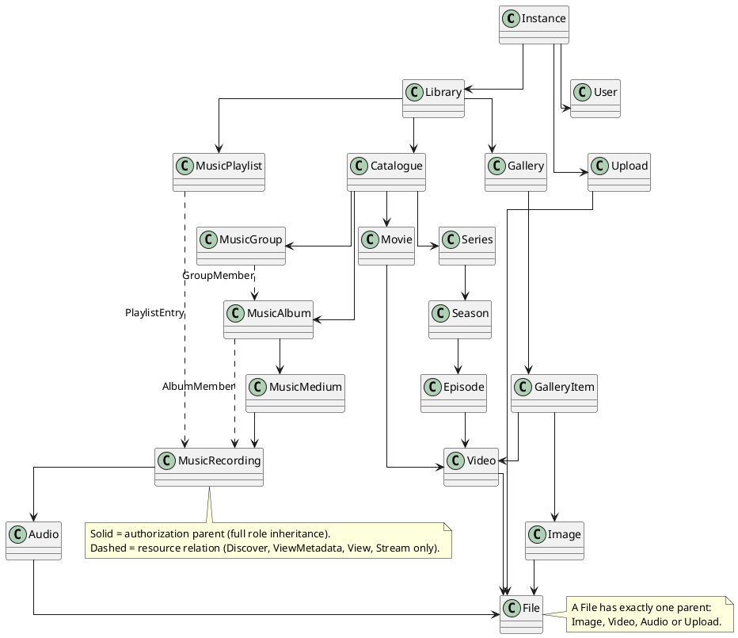

# Permissions

This guide explains how Mnemorium decides whether a caller may perform an action. It describes the
**resource-and-grant** engine: every authorizable thing is a resource, every share is a grant, and every denial has a
reason. The normative contract is the `authorization` capability (`openspec/specs/authorization/spec.md`); this guide is
the human explanation and carries the canonical tree diagram.

The old scope model (`ALL`, `PUBLIC_OR_OWNED`, `OWNED`, `LISTED`, `NONE`) is gone. There is no per-action scope and no
per-user permission override: a grant names a **principal**, a **resource** and a **resource role**.

## Resource tree

Every authorizable entity is a resource. Each resource has exactly one **authorization parent** (a solid arrow), which
is the only edge that inherits a full resource role. `AlbumMember`, `PlaylistEntry` and `GroupMember` are **resource
relations** (dashed arrows): they contain or reference content and lend read access, but they never become an
authorization parent.



A typed asset attaches to the resource it belongs to: a film's video and artwork to the film, an episode's video to the
episode, an album's artwork to the album, a playlist's cover to the playlist, a recording's audio to the recording. The
diagram shows the common cases; each resource still has exactly one solid parent.

### Creation surfaces

Four resources exist only so a `CreateChild` grant has something to attach to. They hold no content child and never
parent one:

| Surface              | Admits                                |
| -------------------- | ------------------------------------- |
| `GalleryCollection`  | A gallery under the library           |
| `PlaylistCollection` | A playlist under the library          |
| `UploadCollection`   | An upload under the instance          |
| `UserCollection`     | A Standard account under the instance |

The surface carries the `CreateChild` grant; the created child's authorization parent is the surface's parent. A surface
therefore never appears in the resource tree above, and it never reaches the content it admits.

### Relations lend read access

A relation lends `Discover`, `ViewMetadata`, `View` and `Stream` from its container to its target and the target's
descendants along the authorization-parent chain when the caller holds that action on the container. It never lends
`Download`, `CreateChild`, `EditMetadata`, `ReplaceMedia`, `Share`, `ManagePermissions` or `Delete`. A matching `Deny`
still wins.

In practice:

- A caller who may view a playlist can listen to every recording in it, even when the recording's own album is not
  shared with the caller.
- The same caller cannot edit, delete or re-share those recordings through the playlist.
- A caller who may view an album can read and stream its `AlbumMember` recordings.
- A caller who may view a music group can read its `GroupMember` albums.
- A deny on the recording itself still blocks the listen, whatever the playlist lends.

## Principals and grants

A **principal** is a user, a role (`Standard` or `Admin`), or the root. A **grant** carries a principal, a resource, a
resource role, a child kind and an effect:

```text
Grant {
  principal:     User(id) | Role(Standard | Admin) | Root
  resource:      Resource
  role:          Viewer | Downloader | Contributor | Editor | Manager | Owner
  child_kind:    All | Gallery | MusicPlaylist | Upload | Movie | Series | Season | Episode |
                 MusicAlbum | MusicMedium | MusicRecording | MusicGroup | GalleryItem | Image |
                 Video | Audio | File | User | Admin
  effect:        Allow | Deny
}
```

Grants are not time-limited in this version. A role grant is seeded by the migration and cannot be edited through HTTP;
the permission API edits user and per-resource grants. A user grant may not name `Owner` or `ManagePermissions`; a
seeded role grant may carry `Owner`. The root is implicit and never stored, and a grant naming the root is refused.

## Actions and resource roles

| Action              | What it allows                                            |
| ------------------- | --------------------------------------------------------- |
| `Discover`          | Know that the resource exists and include it in a listing |
| `ViewMetadata`      | Read its metadata without its content                     |
| `View`              | Read its rendered content                                 |
| `Stream`            | Play its audio or video                                   |
| `Download`          | Retrieve its original bytes                               |
| `CreateChild`       | Create a child of the named `ChildKind`                   |
| `EditMetadata`      | Change its metadata (never visibility or ownership)       |
| `ReplaceMedia`      | Replace its binary content                                |
| `Share`             | Add or revoke `Viewer`/`Downloader` grants                |
| `ManagePermissions` | Change visibility and replace the complete user grant set |
| `Delete`            | Delete it                                                 |
| `ChangeRole`        | Change a user's role (root only)                          |
| `ReplaceCredential` | Replace a credential (root only)                          |

A **resource role** is a bundle of actions:

| Role          | Actions                                       |
| ------------- | --------------------------------------------- |
| `Viewer`      | `Discover`, `ViewMetadata`, `View`, `Stream`  |
| `Downloader`  | `Viewer`, `Download`                          |
| `Contributor` | `Viewer`, `CreateChild`                       |
| `Editor`      | `Contributor`, `EditMetadata`, `ReplaceMedia` |
| `Manager`     | `Editor`, `Share`, `Delete`                   |
| `Owner`       | `Manager`, `ManagePermissions`                |

`Owner` is implicit from ownership and is never a user grant; a seeded role grant may carry it. `ManagePermissions` is
never grantable: it comes from ownership, the Admin role preset on the catalogue and user accounts, or the root.
`ChildKind::Admin` is root-only and is never grantable.

## Visibility

Visibility is a coarse resource-level grant, not a second permission system.

| Visibility   | What authenticated callers get                                      |
| ------------ | ------------------------------------------------------------------- |
| `Private`    | Nothing; the owner and explicit grants decide                       |
| `Restricted` | `Discover` and `ViewMetadata`; content needs a grant                |
| `Public`     | The `Viewer` actions; download, edit, share and delete need a grant |

No visibility implies `Download`, `EditMetadata`, `Share` or `Delete`. Visibility is not inherited: a `Private`
recording inside a `Public` album stays private unless a grant or a relation lends access. A `Deny` beats visibility.
`Public` applies to authenticated callers until an anonymous route exists.

## Ownership

The **owner** is the nearest non-null `owner_id` on the resource or its authorization-parent chain. The owner holds the
implicit `Owner` role, which reaches the resource and its descendants. A gallery owner therefore owns its gallery items;
a playlist owner owns its tracks' placements.

The catalogue (`Catalogue`, `Movie`, `Series`, `Season`, `Episode`, `MusicAlbum`, `MusicMedium`, `MusicRecording`,
`MusicGroup`) has no owner. Its reach is decided by the seeded role grants, visibility and explicit grants. A Standard
User cannot edit or privatise it by default; an Admin can, through `ManagePermissions` on the catalogue.

## Root, uploads and accounts

The **root** is user `0`. It is an implicit owner on every resource, bypasses every deny and has no stored grants. The
one exception is an upload, which is owner-only for every caller, including the root.

| Rule                                    | Who may do it                                                          |
| --------------------------------------- | ---------------------------------------------------------------------- |
| Create an Admin                         | Root only                                                              |
| Change a role                           | Root only                                                              |
| Replace a credential                    | Root only                                                              |
| Create/update/delete a Standard account | Root, or an Admin                                                      |
| Read/update/delete an Admin account     | Root only (a non-root Admin cannot touch another Admin)                |
| Modify or delete the root account       | Nobody                                                                 |
| Curate the catalogue                    | Root, or an Admin through `ManagePermissions` on `Catalogue`           |
| Share an owned resource                 | Its owner, or a `Manager`/`ManagePermissions` holder                   |
| Change visibility                       | Its owner through `ManagePermissions`; Root; an Admin on the catalogue |
| Read its own account                    | Its owner, regardless of grants                                        |

## How a decision is made

For one action on one resource, in order:

1. **Upload owner-only.** An upload is readable, writable and completable only by its owner. The root is not exempt.
2. **Root.** The root is allowed every other action.
3. **Own-account read.** A caller reads its own `User` resource regardless of grants.
4. **Deny.** Any matching `Deny` wins, whether it is on the resource, an ancestor or a role.
5. **Allow.** Any matching `Allow` wins: a grant, the implicit owner, the seeded role, the visibility, or a relation's
   read lend.
6. **Default deny.** No matching allow denies.

The authorization-parent chain is single, acyclic and capped at 32 edges. The decision reads the resource, its chain and
the matching grants in one transaction. A storage error or a malformed row denies.

A decision returns an **explanation**: whether it allowed, the reason (root, owner, visibility, grant, relation, deny or
default), the matching grants, the denying grant, the path and the visibility. Ordinary callers never see grant
internals.

## Denials

| Situation                                    | Response           |
| -------------------------------------------- | ------------------ |
| The caller cannot discover the resource      | `404 Not Found`    |
| The caller can read it but may not modify it | `403 Forbidden`    |
| The caller lacks an administration action    | `403 Forbidden`    |
| The token names a deleted account            | `401 Unauthorized` |

Every denial emits exactly one `authz_failed` security event naming the actor, the action and the target; the `logging`
capability's security-event catalog (`openspec/specs/logging/spec.md`, `REQ-LOGGING-013` and `REQ-LOGGING-010`) declares
those fields, the closed value vocabulary and the event's trigger. A listing that drops an item is not a denial and
emits nothing.

## Permission API

Every permission endpoint lives under `/api/v1/identity`. Nothing permission-related lives under `/user`, `/library` or
`/asset`.

| Method   | Route                                                        | Who may call it                                |
| -------- | ------------------------------------------------------------ | ---------------------------------------------- |
| `GET`    | `/identity/permission?user_id={id}`                          | Self, or `ManagePermissions` on that `User`    |
| `GET`    | `/identity/permission/resource/{kind}/{id}`                  | `Share` or `ManagePermissions` on the resource |
| `PUT`    | `/identity/permission/resource/{kind}/{id}`                  | `ManagePermissions` on the resource            |
| `POST`   | `/identity/permission/resource/{kind}/{id}/share`            | `Share` or `ManagePermissions` on the resource |
| `DELETE` | `/identity/permission/resource/{kind}/{id}/share/{grant_id}` | `Share` or `ManagePermissions` on the resource |

The user summary returns the effective permissions. Add `resource_kind`, `resource_id` and `action` to receive the
explanation for one decision; the full explanation is returned only to a caller holding `ManagePermissions`.

`PUT` replaces the visibility and the complete **user** grant set atomically. Seeded role grants are never edited here.
`POST /share` accepts only `Viewer` and `Downloader` `Allow` grants; it cannot escalate or deny.

### Examples

Share a playlist with one user as a viewer:

```http
POST /api/v1/identity/permission/resource/MUSIC_PLAYLIST/12/share
Authorization: Bearer <token>
Content-Type: application/json

{
  "principal": { "kind": "USER", "id": 5 },
  "role": "VIEWER"
}
```

The user can now discover, read and stream the playlist and, through the `PlaylistEntry` relation, listen to its
recordings. They cannot edit, download, re-share or delete them.

Protect one recording from everybody but its owner:

```http
PUT /api/v1/identity/permission/resource/MUSIC_RECORDING/42
Authorization: Bearer <token>
Content-Type: application/json

{
  "visibility": "PRIVATE",
  "grants": [
    { "principal": { "kind": "USER", "id": 5 }, "role": "VIEWER", "effect": "ALLOW" }
  ]
}
```

Make a gallery public:

```http
PUT /api/v1/identity/permission/resource/GALLERY/9
Authorization: Bearer <token>
Content-Type: application/json

{ "visibility": "PUBLIC", "grants": [] }
```

Ask why a user cannot read an album:

```http
GET /api/v1/identity/permission?user_id=5&resource_kind=MUSIC_ALBUM&resource_id=21&action=view
Authorization: Bearer <root-or-manager-token>
```

The response carries the decision and its explanation. An ordinary caller reading its own summary receives the effective
permissions, not the grant internals.

## Migration

The old `permission` and `permission_resource` tables are dropped. The migration creates `resource`, `resource_relation`
and `grant`, backfills one resource row per existing entity, seeds the `Standard` and `Admin` role grants, and discards
every old scope override. There is no translation: a `gallery.read: ALL` override has no faithful grant equivalent, and
the project is pre-release.
