# Entity-relationship diagram

The entity-relationship diagram tracks `migrations/`.

```puml
@startuml

hide empty members

entity credential {
   * credential_id: INTEGER <<PK>>
   --
   * password_hash: TEXT <<NN, UN>>
   * updated_at: TEXT <<NN, DF(CURRENT_TIMESTAMP)>>
}

entity user {
   * user_id: INTEGER <<PK>>
   --
   * role: VARCHAR(50) <<NN, CC(role IN ('ADMIN', 'STANDARD'))>>
   * username: VARCHAR(100) <<NN, UN, CC(length(username) >= 4)>>
   * email: TEXT <<UN, CC(email LIKE '%_@_%._%')>>
   * credential_id: INTEGER <<FK, UN, NN>>
}

entity music_album {
   * music_album_id: INTEGER <<PK>>
   * name: TEXT <<NN, UN(name, music_group_id)>>
   release_date: DATE
   production_type: VARCHAR(20) <<CC(production_type IN ('COMPILATION', 'DJMIX', 'DEMO', 'LIVE', 'MIXTAPE', 'REMIX', 'SOUNDTRACK', 'STUDIO'))>>
   cover_image_id: INTEGER <<FK>>
   * music_group_id: INTEGER <<FK, NN, UN(name, music_group_id)>>
}

entity music_medium {
   * music_medium_id: INTEGER <<PK>>
   --
   * music_album_id: INTEGER <<FK, NN>>
   * type: TEXT <<NN, CC(type IN ('CD', 'DIGITAL'))>>
   * medium_index: INTEGER <<NN, DF(1), CC(medium_index BETWEEN 0 AND 255)>>
}

entity music_track {
   * music_track_id: INTEGER <<PK>>
   --
   * track_index: INTEGER <<NN, CC(track_index >= 0), CC(music_medium_id IS NULL OR track_index BETWEEN 0 AND 255), CC(music_playlist_id IS NULL OR track_index <= 4294967295)>>
   * music_playlist_id: INTEGER <<FK, CC((music_medium_id IS NOT NULL) <> (music_playlist_id IS NOT NULL))>>
   * music_medium_id: INTEGER <<FK, CC((music_medium_id IS NOT NULL) <> (music_playlist_id IS NOT NULL))>>
   * music_recording_id: INTEGER <<FK, NN>>
}

entity music_recording {
   * music_recording_id: INTEGER <<PK>>
   --
   * name: TEXT
   * isrc_code: VARCHAR(12) <<UN>>
   * audio_id: INTEGER <<FK, NN>>
}

entity music_playlist {
   * music_playlist_id: INTEGER <<PK>>
   --
   * name: TEXT <<NN, UN(user_id, name)>>
   * created_at: TEXT <<NN, DF(CURRENT_TIMESTAMP)>>
   * last_modified_at: TEXT <<NN, DF(CURRENT_TIMESTAMP)>>
   * user_id: INTEGER <<FK, NN>>
   * is_public: BOOLEAN <<NN, DF(0)>>
   cover_image_id: INTEGER <<FK>>
}

entity audio {
   * audio_id: INTEGER <<PK>>
   --
   * name: TEXT <<NN>>
   * duration_ms: REAL <<NN, CC(duration_ms >= 0)>>
   * codec: TEXT <<NN>>
   * sample_rate_hz: REAL <<NN, CC(sample_rate_hz >= 0)>>
   bit_depth: INTEGER <<CC(bit_depth IS NULL OR bit_depth > 0)>>
   block_size: INTEGER <<CC(block_size IS NULL OR block_size > 0)>>
   * file_id: INTEGER <<FK, NN, UN>>
}

entity genre {
   * genre_id: TEXT <<PK>>
}

entity music_recording_genre {
   * music_recording_id: INTEGER <<FK, PK>>
   * genre_id: TEXT <<FK, PK>>
}

entity music_album_genre {
   * music_album_id: INTEGER <<FK, PK>>
   * genre_id: TEXT <<FK, PK>>
}

entity movie_genre {
   * movie_id: INTEGER <<FK, PK>>
   * genre_id: TEXT <<FK, PK>>
}

entity music_group {
   * music_group_id: INTEGER <<PK>>
   --
   * stage_name: VARCHAR(50) <<NN, UN>>
   cover_image_id: INTEGER <<FK>>
}

entity person {
   * person_id: INTEGER <<PK>>
   --
   * given_name: VARCHAR(50) <<NN>>
   * family_name: VARCHAR(50)
   * birth_date: DATE
}

entity music_group_person {
   * music_group_id: INTEGER <<FK, PK>>
   * person_id: INTEGER <<FK, PK>>
}

entity music_recording_group {
   * music_recording_id: INTEGER <<FK, PK>>
   * music_group_id: INTEGER <<FK, PK>>
}

entity music_album_group {
   * music_album_id: INTEGER <<FK, PK>>
   * music_group_id: INTEGER <<FK, PK>>
}

entity file {
   * file_id: INTEGER <<PK>>
   --
   * path: TEXT <<NN, UN>>
   * user_id: INTEGER <<FK, NN>>
   * is_public: BOOLEAN <<NN, DF(0)>>
   * mime_type_id: TEXT <<FK, NN>>
   * uploaded_at: DATE <<NN, DF(date('now'))>>
   * size_bytes: INTEGER <<NN>>
   * modified_at: TEXT <<NN>>
   * origin: TEXT <<NN, DF('SCANNED'), CC(origin IN ('UPLOADED', 'SCANNED'))>>
   integrity_hash: CHAR(64) <<CC(integrity_hash IS NULL OR length(integrity_hash) = 64)>>
}

entity upload {
   * upload_id: INTEGER <<PK>>
   --
   * user_id: INTEGER <<FK, NN>>
   * file_name: TEXT <<NN>>
   * file_size: INTEGER <<NN, CC(file_size > 0)>>
   * mime_type_id: TEXT <<FK, NN>>
   * chunk_size: INTEGER <<NN, CC(chunk_size > 0)>>
   * integrity_hash: CHAR(64) <<NN, CC(length(integrity_hash) = 64)>>
   * is_finished: BOOLEAN <<NN, DF(0), CC(is_finished IN (0, 1))>>
   * created_at: TEXT <<NN, DF(CURRENT_TIMESTAMP)>>
}

entity upload_chunk {
   * upload_id: INTEGER <<FK, PK>>
   * chunk_number: INTEGER <<PK, CC(chunk_number >= 0)>>
}

entity mime_type {
   * mime_type_id: TEXT <<PK>>
   * type: TEXT <<NN, CC(type IN ('AUDIO', 'VIDEO', 'IMAGE'))>>
}

entity video {
   * video_id: INTEGER <<PK>>
   --
   * duration_ms: REAL <<NN, CC(duration_ms >= 0)>>
   * codec: VARCHAR(20) <<NN>>
   * frame_count: INTEGER <<NN, CC(frame_count > 0)>>
   * width: INTEGER <<NN, CC(width > 0)>>
   * height: INTEGER <<NN, CC(height > 0)>>
   * color_id: TEXT <<FK, NN>>
   * scan_type: VARCHAR(20) <<NN, CC(scan_type IN ('PROGRESSIVE', 'INTERLACED', 'MBAFF', 'PAFF'))>>
   scope: VARCHAR(20) <<CC(scope IN ('LIBRARY', 'USER'))>>
   * file_id: INTEGER <<FK, NN, UN>>
}

entity movie {
   * movie_id: INTEGER <<PK>>
   --
   * name: TEXT <<NN>>
   * plot: TEXT <<NN>>
   country_of_origin: VARCHAR(30)
   release_date: DATE
   * video_id: INTEGER <<FK, NN, UN>>
   cover_image_id: INTEGER <<FK>>
}

entity series {
   * series_id: INTEGER <<PK>>
   --
   * name: TEXT <<NN>>
   * plot: TEXT <<NN>>
   country_of_origin: VARCHAR(30)
   first_air_date: DATE
   cover_image_id: INTEGER <<FK>>
}

entity series_genre {
   * series_id: INTEGER <<FK, PK>>
   * genre_id: TEXT <<FK, PK>>
}

entity season {
   * season_id: INTEGER <<PK>>
   --
   * series_id: INTEGER <<FK, NN>>
   * season_index: INTEGER <<NN, DF(0), CC(season_index BETWEEN 0 AND 4294967295)>>
   name: TEXT
   cover_image_id: INTEGER <<FK>>
}

entity episode {
   * episode_id: INTEGER <<PK>>
   --
   * season_id: INTEGER <<FK, NN>>
   * episode_index: INTEGER <<NN, CC(episode_index BETWEEN 0 AND 4294967295)>>
   * name: TEXT <<NN>>
   * plot: TEXT <<NN>>
   air_date: DATE
   * video_id: INTEGER <<FK, NN, UN>>
}

entity language {
   * language_id: INTEGER <<PK>>
   --
   * english_name: VARCHAR(50) <<NN, UN>>
   * native_name: VARCHAR(50) <<NN, UN>>
   * code: VARCHAR(2) <<NN, UN>>
}

entity stream {
   * stream_id: INTEGER <<PK>>
   --
   * stream_index: INTEGER <<NN>>
   * name: TEXT <<NN>>
   * is_default: BOOLEAN <<NN, DF(0)>>
   * video_id: INTEGER <<FK, NN>>
}

entity audio_stream {
   * audio_stream_id: INTEGER <<PK>>
   --
   * is_commentary: BOOLEAN <<NN, DF(0)>>
   * stream_id: INTEGER <<FK, NN, UN>>
   * audio_id: INTEGER <<FK, NN>>
   * language_id: INTEGER <<FK, NN>>
}

entity subtitle_stream {
   * subtitle_stream_id: INTEGER <<PK>>
   --
   * is_forced: BOOLEAN <<NN, DF(0)>>
   * stream_id: INTEGER <<FK, NN, UN>>
   * language_id: INTEGER <<FK, NN>>
}

entity image {
   * image_id: INTEGER <<PK>>
   --
   * name: TEXT <<NN>>
   * width_px: INTEGER <<NN, CC(width_px > 0)>>
   * height_px: INTEGER <<NN, CC(height_px > 0)>>
   * orientation: VARCHAR(20) <<NN, CC(orientation IN ('LANDSCAPE', 'PORTRAIT', 'SQUARE'))>>
   * created_at: DATE <<NN>>
   scope: VARCHAR(20) <<CC(scope IN ('LIBRARY', 'USER'))>>
   * file_id: INTEGER <<FK, NN, UN>>
}

entity color {
   * color_id: TEXT <<PK>>
   --
   * description: TEXT <<NN>>
}

entity gallery {
   * gallery_id: INTEGER <<PK>>
   --
   * name: TEXT <<NN>>
   * created_at: TEXT <<NN>>
   * last_modified_at: TEXT <<NN>>
   * is_public: BOOLEAN <<NN>>
   user_id: INTEGER <<FK>>
}

entity gallery_item {
   * gallery_item_id: INTEGER <<PK>>
   --
   * gallery_id: INTEGER <<FK, NN>>
   image_id: INTEGER <<FK, UN>>
   video_id: INTEGER <<FK, UN>>
   * item_index: INTEGER <<NN, CC(item_index >= 0)>>
   * added_at: TEXT <<NN, DF(CURRENT_TIMESTAMP)>>
}

entity resource {
   * resource_id: INTEGER <<PK>>
   --
   * kind: TEXT <<NN, CC(kind IN ('INSTANCE', 'LIBRARY', 'CATALOGUE', 'USER', 'UPLOAD', 'GALLERY', 'GALLERY_ITEM', 'MOVIE', 'SERIES', 'SEASON', 'EPISODE', 'MUSIC_GROUP', 'MUSIC_ALBUM', 'MUSIC_MEDIUM', 'MUSIC_RECORDING', 'MUSIC_PLAYLIST', 'IMAGE', 'VIDEO', 'AUDIO', 'FILE', 'GALLERY_COLLECTION', 'PLAYLIST_COLLECTION', 'UPLOAD_COLLECTION', 'USER_COLLECTION'))>>
   * entity_id: INTEGER <<NN, UN(kind, entity_id)>>
   owner_id: INTEGER <<FK>>
   auth_parent_id: INTEGER <<FK>>
   * visibility: TEXT <<NN, CC(visibility IN ('PRIVATE', 'RESTRICTED', 'PUBLIC')), DF(PRIVATE)>>
}

entity resource_relation {
   * from_resource_id: INTEGER <<PK, FK, NN>>
   * to_resource_id: INTEGER <<PK, FK, NN>>
   * kind: TEXT <<PK, NN, CC(kind IN ('ALBUM_MEMBER', 'PLAYLIST_ENTRY', 'GROUP_MEMBER'))>>
   position: INTEGER <<CC(position IS NULL OR position >= 0)>>
}

entity grant {
   * grant_id: INTEGER <<PK>>
   --
   * principal_kind: TEXT <<NN, CC(principal_kind IN ('USER', 'ROLE'))>>
   principal_id: INTEGER
   principal_role: VARCHAR(50)
   * resource_id: INTEGER <<FK, NN>>
   * role: TEXT <<NN, CC(role IN ('VIEWER', 'DOWNLOADER', 'CONTRIBUTOR', 'EDITOR', 'MANAGER', 'OWNER'))>>
   * child_kind: TEXT <<NN, CC(child_kind IN ('ALL', 'GALLERY', 'MUSIC_PLAYLIST', 'UPLOAD', 'USER', 'ADMIN', 'MOVIE', 'SERIES', 'SEASON', 'EPISODE', 'MUSIC_GROUP', 'MUSIC_ALBUM', 'MUSIC_MEDIUM', 'MUSIC_RECORDING', 'GALLERY_ITEM', 'IMAGE', 'VIDEO', 'AUDIO', 'FILE')), DF(ALL)>>
   * effect: TEXT <<NN, CC(effect IN ('ALLOW', 'DENY'))>>
}


user ||--|| credential
user ||--o{ music_playlist
user ||--o{ gallery
user ||--o{ file
user ||--o{ upload
upload ||--o{ upload_chunk

music_album ||--o{ music_medium
music_album ||--o{ music_album_genre
music_album ||--o{ music_album_group

music_medium ||--o{ music_track

music_playlist ||--o{ music_track

music_recording ||--o{ music_track

audio ||--|| music_recording
audio ||--|| file

music_recording ||--o{ music_recording_genre
music_recording ||--o{ music_recording_group

genre ||--o{ music_album_genre
genre ||--o{ music_recording_genre
genre ||--o{ movie_genre

mime_type ||--o{ file
mime_type ||--o{ upload

music_group ||--o{ music_group_person
music_group ||--o{ music_recording_group
music_group ||--o{ music_album_group
music_group ||--o{ music_album

person ||--o{ music_group_person

video ||--|| file
video ||--|| color

image ||--|| file

movie ||--|| video
movie ||--o{ movie_genre
file ||--o{ movie

series ||--o{ series_genre
series ||--o{ season
season ||--o{ episode
episode ||--|| video
file ||--o{ series
file ||--o{ season

music_album ||--o{ music_medium
music_album ||--o{ music_album_genre
music_album ||--o{ music_album_group
file ||--o{ music_album

music_playlist ||--o{ music_track
file ||--o{ music_playlist

genre ||--o{ series_genre

stream ||--o| audio_stream
stream ||--o| subtitle_stream

audio_stream ||--|| audio
language ||--o{ audio_stream
language ||--o{ subtitle_stream

gallery ||--o{ gallery_item
image ||--o| gallery_item
video ||--o| gallery_item

user ||--o{ resource
resource ||--o{ resource
resource ||--o{ resource_relation
resource ||--o{ grant

@enduml
```



## Legend

| Decorator | Description      |
| --------- | ---------------- |
| PK        | Primary Key      |
| FK        | Foreign Key      |
| NN        | NOT NULL         |
| UN        | UNIQUE           |
| CC        | CHECK constraint |
| DF        | DEFAULT value    |

The `music_medium` entity enforces a composite unique key on `(music_album_id, medium_index)`
(`uq_music_medium_album_medium_index`): an album holds at most one medium at a given index.

The `music_track` entity enforces three partial unique indexes, `uq_music_track_medium_track_index` on
`(music_medium_id, track_index)`, `uq_music_track_playlist_track_index` on `(music_playlist_id, track_index)` and
`uq_music_track_playlist_recording` on `(music_playlist_id, music_recording_id)`, each restricted to the rows where its
container column is set: a medium and a playlist each sequence at most one track at a given index, and a playlist holds
at most one occurrence of a given recording. A track is placed in exactly one container
(`chk_music_track_one_container`), and a playlist track index cannot exceed the domain's `u32` range
(`chk_music_track_playlist_track_index`). The playlist foreign key cascades: deleting a playlist removes its track
placements while the shared recordings, audio and files survive (`PERS-020`).

The `music_playlist` entity enforces a composite unique key on `(user_id, name)` (`uq_music_playlist_user_id_name`): a
caller owns at most one playlist per name, while different callers may each own a playlist with the same name.

The `file` entity enforces a composite unique key on `(user_id, integrity_hash)`: a caller stores one file record per
integrity hash, while different callers may each store their own copy. `integrity_hash` is nullable: an uploaded file
carries the digest that verifies its content and deduplicates it, while a scanned file carries none, and `SQLite` treats
`NULL` values as distinct, so the unique key does not apply to a scanned row.

The six resources that may carry artwork -- `movie`, `series`, `season`, `music_album`, `music_group` and
`music_playlist` -- each hold a nullable `cover_image_id` into `image` (`fk_<table>_cover_image`). The reference crosses
into the Asset bounded context, so it declares no `ON DELETE CASCADE`: deleting an image a cover references is rejected
by the foreign key and stays orchestrated by the application (`PERS-020`). An `image` row exists only for a probed image
file, so the foreign key alone guarantees that a cover is an image; a dangling identifier is rejected as a
data-integrity violation.

An `image` or `video` row carries a nullable `scope` (`LIBRARY` or `USER`) that its first attachment fixes. A catalogue
cover's trigger pair, `tg_<table>_cover_scope_insert` and `tg_<table>_cover_scope_update`, marks the referenced image
`LIBRARY`; a playlist cover or gallery item marks its image or video `USER`. A value already fixed in the other
direction raises `ABORT`, which `PERS-017` maps to a conflict, and `tg_image_scope_is_immutable` /
`tg_video_scope_is_immutable` refuse every later change. A `NULL` cover never fires a guard.

The `music_album` entity enforces a composite unique key on `(name, music_group_id)`
(`uq_music_album_name_music_group_id`): a group has at most one album per name, while another group may hold an album
with the same name. `release_date` is nullable, so an album the provider does not date stores no date instead of a
fabricated one.

The seeded music bucket is `genre('UNKNOWN')`, `music_group` 0 (`stage_name` `Unknown`), `music_album` 0 (name
`Unknown`, no release date, group 0) linked to that genre, and one `DIGITAL` medium at album-scoped index 1
(`PERS-005`). `tg_music_group_delete_unknown` / `tg_music_group_update_unknown`, `tg_music_album_delete_unknown` /
`tg_music_album_update_unknown` and `tg_music_medium_delete_unknown` / `tg_music_medium_update_unknown` refuse deleting
or modifying each, mirroring the default gallery. The bucket is readable like any other album and appears in album
listings.

The `gallery` entity enforces a composite unique key on `(user_id, name)` (`uq_gallery_user_id_name`): a caller owns at
most one gallery per name, while different callers may each own a gallery with the same name. `user_id` is nullable, and
SQLite treats `NULL` values as distinct, so the ownerless default gallery (identifier `0`) stays outside the constraint
and unique by its fixed identifier (`PERS-021`).

The `gallery_item` entity stores either an `image` or a `video`, never both (`chk_gallery_item_one_media`). Two partial
unique indexes, `uq_gallery_item_image_id` and `uq_gallery_item_video_id`, keep a media row in at most one gallery item,
and `UNIQUE(gallery_id, item_index)` keeps the item order unique within a gallery. A `USER` image has exactly one
referrer: `uq_gallery_item_image_id`, `uq_music_playlist_cover_image_id` and the scope triggers reject a second gallery
item, a second playlist cover, or a gallery item and a playlist cover sharing the image, while a `LIBRARY` image is
shared freely by catalogue covers. `ON DELETE CASCADE` is limited to one bounded context (`PERS-020`); the cross-context
`file` foreign keys on `image` and `video` do not cascade.

## Removal cascade

When the scan no longer finds a registered file it reconciles the removal in one unit of work, ordered so every foreign
key holds:

```text
image -> cover_image_id set to NULL on music_group, music_album, music_playlist, movie, series and season;
         gallery_item rows of the image; the image row
video -> stream rows (and their audio/subtitle descriptors); the movie or the episode that requires it;
         gallery_item rows of the video; the video row
audio -> music_recording (with its group/genre links and its music_track placements); audio_stream rows; the audio row
then  -> the file row
```

The aggregate report counts a completed removal as `removed`; a removal that fails rolls the unit of work back, keeps
the record, reports the file as `missing` and lets the scan continue. A file that reappears after its removal is
registered as a new record rather than restoring the removed one. Content under the library root is never changed.

## Authorization resource graph

The authorization engine stores its state in three tables, created by one migration that also backfills the resource
graph and seeds the role grants.

- **`resource`** holds one row per authorizable entity: a surrogate `resource_id`, the `(kind, entity_id)` external
  address, a nullable `owner_id`, a nullable `auth_parent_id` and a `visibility`. `(kind, entity_id)` is unique; the
  kind and visibility are constrained to the catalog; a resource cannot parent itself; a `USER` resource carries no
  owner and a catalogue resource carries no owner (`chk_resource_user_has_no_owner`,
  `chk_resource_catalogue_has_no_owner`). A gallery, a playlist and a typed asset carry their user as owner; the
  `Instance`, `Library`, `Catalogue`, the four creation surfaces and every catalogue resource carry none.
- **`resource_relation`** holds the containment and reference edges (`ALBUM_MEMBER`, `PLAYLIST_ENTRY`, `GROUP_MEMBER`)
  with an optional `position`, keyed by `(from_resource_id, to_resource_id, kind)`. A partial unique index on
  `(from_resource_id, kind, position)` makes an order unique, and a self-edge is rejected. The edge lends read actions
  only and never becomes an authorization parent.
- **`grant`** holds one row per grant: `principal_kind` (`USER` or `ROLE`), the user identifier or the role, the
  addressed `resource_id`, a resource role, a `child_kind` and an `effect` (`ALLOW` or `DENY`). `Owner` is allowed only
  for a role principal, `ChildKind::Admin` is never grantable, and the principal/effect pair is unique through the
  partial indexes `uq_grant_user` and `uq_grant_role`; two partial indexes replace one composite key because SQLite
  treats `NULL` values as distinct.

The `auth_parent_id` column is the only inheritance edge. A write rejects a cycle and a chain deeper than 32 in the same
transaction as the assignment; the decision walks at most 32 edges. The backfill runs in this order: the `Instance`,
`Library` and `Catalogue` singletons and the four creation surfaces; one row per existing gallery, playlist, user,
upload, typed asset and file; the album, playlist and group relations; the `Standard` and `Admin` role grants. No stored
override is translated, because an `ALL`/`LISTED`/`OWNED`/`NONE` scope has no faithful grant equivalent and the project
is pre-release (`REQ-AUTHORIZATION-037`).

A decision reads the resource, its authorization-parent chain and the matching grants in one read transaction; a storage
error, a malformed row or a missing resource denies. A listing reads the caller's grants once and filters the page
without emitting an `authz_failed` event.
