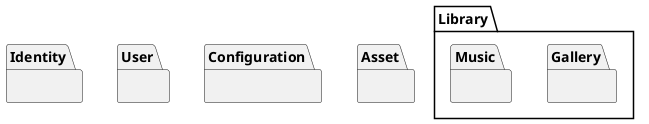
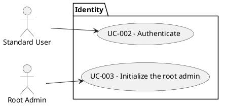
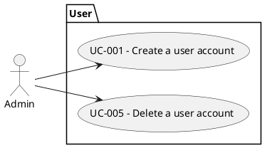
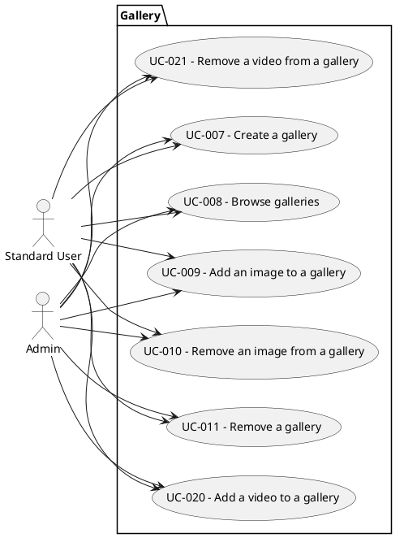
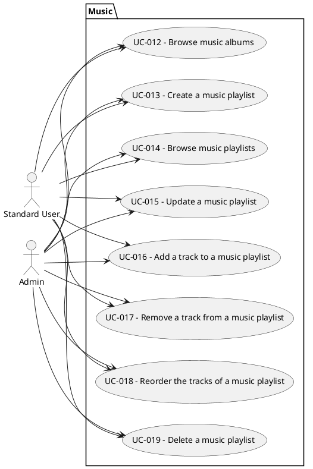
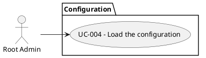
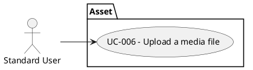

# Use Cases

Catalog of the **business use cases** of Mnemorium. Each entry describes a capability initiated by an actor; it is a
business-level view, not a one-to-one list of the application's implementation units.

A business use case is implemented by one or more **application use cases** — the `port/<name>.rs` /
`use_case/<name>.rs` pair governed by [TechnicalDesign.md](TechnicalDesign.md) § 9 (Use cases). The catalog does not
list them: an entry describes the capability, not the code that implements it.

The entry format is the contract in [TechnicalDesign.md](TechnicalDesign.md) § 5 (Business use case format), `DOC-005`,
`DOC-007` and `DOC-008`: the fields, the trigger doctrine, the parameters and the diagram conventions all live there. An
entry states intent and outcome in business terms; the validation criteria of a capability belong to its specification,
never to its entry.

The catalog is organised by package, following the [Overview](Overview.md#bounded-context). A bounded context is a
package, and a context that divides into areas lists them as sub-packages. Each package carries its diagram and the
entries it owns, so the section an entry sits in is its package. A capability that spans several packages is filed where
it is owned; `STY-RUST-040` records the cross-context units of work.

The master diagram below is the package view of the whole catalog:

## Identity

### UC-002 - User Authentication

#### Description

Allow a registered user to securely authenticate with the system using valid credentials and gain access to authorized
features and resources.

#### Primary actor

- Standard User

#### Parameters

- username — the account name the user presents; required.
- password — the secret the user presents; required.

#### Pre condition(s)

- The user is registered: an account with its credential exists in the system.

#### Trigger

- The user submits an authentication request.

#### Happy path

1. The user submits an authentication request.
2. The system finds the user by username.
3. The system verifies the password against the password the account holds.
4. The system issues a token identifying the user.
5. The user gains access to the authorized features and resources.

#### Alternative flow

- 2a. Bad credentials: no account matches the username, or the password does not match the password the account holds;
  the system rejects the request.

#### Post condition(s)

- The user holds a valid token granting access to authorized features and resources.

---

### UC-003 - Initialize Root Admin

#### Description

On the first runtime the system creates the Root Admin account, issues and reveals a default password to the operator,
and lets the Root Admin replace it with a personal password. The default password stops being revealed once it has been
changed.

#### Primary actor

- Root Admin

#### Parameters

- default password — the generated password the operator was shown; required.
- new password — the personal password the Root Admin chooses; required.

#### Pre condition(s)

- First-Time Admin Authentication is enabled in configuration.
- The default password corresponding to the Root Admin account has not been replaced yet.

#### Trigger

- The Root Admin starts the service with First-Time Admin Authentication enabled.

#### Happy path

1. The Root Admin starts the service.
2. The system checks whether a Root Admin account exists; none does, so the system creates the account with a generated
   default password.
3. The system shows the default password to the operator.
4. The Root Admin submits an authentication request.
5. The system verifies the default password against the password the account holds.
6. The system validates the new password.
7. The system secures the new password, replaces the credential, and the default password stops being shown.
8. The system returns the updated account.

#### Alternative flow

- 2a. A Root Admin already exists: the system stops at step 1 and the functionality stays inactive — no new account and
  no revealed password.
- 5a. Bad password: the default password does not match the password the account holds; the system rejects the request.
- 6a. The new password cannot be used; the system rejects the request.

#### Post condition(s)

- A Root Admin account exists in the system.
- The Root Admin holds a personal credential.
- The default password is no longer valid and is no longer shown to the operator while the configuration has First-Time
  Admin Authentication enabled.

## User

### UC-001 - Create a User Account

#### Description

Allow an Administrator to create a new user in the system and assign the appropriate profile information.

#### Primary actor

- Admin

#### Parameters

- username — the account name of the new user; required.
- email — an optional contact address.
- password — the secret the new user authenticates with; required.
- role — the profile to grant the new user; required.

#### Pre condition(s)

- The caller is authenticated as an Admin.

#### Trigger

- The Admin submits a user-creation request.

#### Happy path

1. The Admin submits a user-creation request.
2. The system validates the request.
3. The system verifies the caller may grant the requested role.
4. The system verifies that no user already exists with the username or email.
5. The system secures the password and saves the new user with its credential.
6. The system returns the created account.

#### Alternative flow

- 2a. The request is invalid: a required value is missing or cannot be used; the system rejects the request and creates
  nothing.
- 3a. The Admin is not the Root Admin and requests the Admin role for the new user; the system rejects the request and
  creates nothing.

#### Post condition(s)

- A new user account and its credential exist in the system.
- Username and email remain unique across users.

---

### UC-005 - Delete User Account

#### Description

Allow an Administrator to remove a user account together with all the data it owns, and prevent the affected user from
accessing the system.

#### Primary actor

- Admin

#### Parameters

- user — the account to remove; required.

#### Pre condition(s)

- The caller is authenticated as an Admin.

#### Trigger

- The Admin submits a user-deletion request.

#### Happy path

1. The Admin submits a user-deletion request.
2. The system verifies the target user exists.
3. The system verifies the target user is not the Root Admin.
4. The system deletes the data owned by the user and then the account with its credential.
5. The system stops accepting the tokens issued to the deleted user.
6. The system confirms the deletion.

#### Alternative flow

- 1a. The caller is not an Admin; the system rejects the request.
- 2a. No user exists for the requested account; the system rejects the request.
- 3a. The target user is the Root Admin; the system rejects the request.

#### Post condition(s)

- The user account and its credential no longer exist.
- Every file, playlist, and dependent media record owned by the user no longer exists.
- The deleted user cannot authenticate and any token it held is rejected.

## Library

### Gallery

#### UC-007 - Create a Gallery

##### Description

Allow an authenticated user to create a gallery they own to collect images and videos.

##### Primary actor

- Standard User
- Admin

##### Parameters

- name — the gallery name; required.
- visibility — whether other users may read the gallery; optional, private by default.

##### Pre condition(s)

- The caller is authenticated.

##### Trigger

- The caller submits a gallery-creation request.

##### Happy path

1. The caller submits a gallery-creation request.
2. The system trims and validates the name.
3. The system verifies the caller does not already own a gallery with the same name.
4. The system creates the gallery owned by the caller.
5. The system returns the created gallery.

##### Alternative flow

- 2a. The name cannot be used: it is empty, only whitespace, or too long; the system rejects the request and creates
  nothing.
- 3a. The caller already owns a gallery with the same name; the system rejects the request and creates nothing.

##### Post condition(s)

- A gallery owned by the caller exists.
- The new gallery holds no item.

---

#### UC-008 - Browse Galleries

##### Description

Allow an authenticated user to browse the galleries and items they may see.

##### Primary actor

- Standard User
- Admin

##### Parameters

- filter — an optional narrowing of the listing by name, visibility and owner.
- page — an optional position in the listing.
- gallery — the gallery to read, when reading one; optional.
- item — the item to read, when reading one; optional.

##### Pre condition(s)

- The caller is authenticated.

##### Trigger

- The caller asks to list the galleries it may see.
- The caller asks to read one gallery.
- The caller asks to list the items of one gallery.
- The caller asks to read one item of one gallery.

##### Happy path

1. The caller lists galleries, optionally filtering and paging.
2. The system returns every gallery the caller may see, each with its item count.
3. The caller requests one gallery by its identifier.
4. The system returns the gallery with its items in order.
5. The caller requests one item of the gallery.
6. The system returns the item with its media metadata.

##### Alternative flow

- 2a. The caller requests a private gallery it neither owns nor reads as the Root Admin; the system rejects the request.
- 3a. No gallery matches the requested identifier; the system rejects the request.
- 5a. No item matching the requested identifier belongs to the gallery; the system rejects the request.

##### Post condition(s)

- The caller holds the requested galleries and items.

---

#### UC-009 - Add an Image to a Gallery

##### Description

Allow an authenticated user to append one of their images to a gallery they may contribute to.

##### Primary actor

- Standard User
- Admin

##### Parameters

- gallery — the gallery to append the image to; required.
- image — the image to append; required.

##### Pre condition(s)

- The caller is authenticated.

##### Trigger

- The caller submits a request to add an image to a gallery.

##### Happy path

1. The caller submits a request to add an image to a gallery.
2. The system verifies the caller may contribute to the gallery.
3. The system resolves the image and its backing file.
4. The system verifies the caller owns the backing file, or is the Root Admin.
5. The system verifies the image is not already in a gallery.
6. The system appends the item at the next order position.
7. The system returns the created item.

##### Alternative flow

- 1a. The named medium is not an image; the system rejects the request.
- 2a. The gallery is private and the caller is neither its owner nor the Root Admin; the system rejects the request.
- 2b. No gallery matches the requested identifier; the system rejects the request.
- 3a. No image matches the requested identifier; the system rejects the request.
- 4a. The image belongs to another user and the caller is not the Root Admin; the system rejects the request.
- 5a. The image already belongs to a gallery; the system rejects the request.

##### Post condition(s)

- The gallery holds the new item at the next order position.
- The image belongs to this gallery.

---

#### UC-010 - Remove an Image from a Gallery

##### Description

Allow an authenticated user to remove an image from a gallery, permanently deleting the item, its medium, and — when the
caller owns the file — the backing file.

##### Primary actor

- Standard User
- Admin

##### Parameters

- gallery — the gallery to remove the image from; required.
- image — the image to remove; required.

##### Pre condition(s)

- The caller is authenticated.

##### Trigger

- The caller submits a request to remove an image from a gallery.

##### Happy path

1. The caller submits a removal request.
2. The system verifies the caller may remove items of the gallery.
3. The system locates the image's item within the gallery.
4. The system deletes the item and its image record, and the backing file when the caller owns it.
5. The system confirms the removal.

##### Alternative flow

- 2a. The gallery is private and the caller is neither its owner nor the Root Admin; the system rejects the request.
- 2b. No gallery matches the requested identifier; the system rejects the request.
- 3a. The image is not in the gallery named in the request; the system reports it as not found.

##### Post condition(s)

- The item and its image record no longer exist.
- The backing file's record and stored content no longer exist when the caller owned the file.

---

#### UC-011 - Remove a Gallery

##### Description

Allow the owner to delete a gallery together with its items, their media, and the backing files.

##### Primary actor

- Standard User
- Admin

##### Parameters

- gallery — the gallery to delete; required.

##### Pre condition(s)

- The caller is authenticated.

##### Trigger

- The caller submits a gallery-deletion request.

##### Happy path

1. The caller submits a request to delete one of its galleries.
2. The system verifies the gallery is not the default gallery.
3. The system verifies the caller owns the gallery.
4. The system deletes every item, its image or video record, and its backing file.
5. The system deletes the gallery.
6. The system confirms the deletion.

##### Alternative flow

- 1a. No gallery matches the requested identifier; the system rejects the request.
- 2a. The gallery is the default gallery; the system rejects the request.
- 3a. The caller is not the owner; the system rejects the request.

##### Post condition(s)

- The gallery, its items, their media, and their backing files no longer exist.

---

#### UC-020 - Add a Video to a Gallery

##### Description

Allow an authenticated user to append one of their videos to a gallery they may contribute to.

##### Primary actor

- Standard User
- Admin

##### Parameters

- gallery — the gallery to append the video to; required.
- video — the video to append; required.

##### Pre condition(s)

- The caller is authenticated.

##### Trigger

- The caller submits a request to add a video to a gallery.

##### Happy path

1. The caller submits a request to add a video to a gallery.
2. The system verifies the caller may contribute to the gallery.
3. The system resolves the video and its backing file.
4. The system verifies the caller owns the backing file, or is the Root Admin.
5. The system verifies the video is not already in a gallery.
6. The system appends the item at the next order position.
7. The system returns the created item.

##### Alternative flow

- 1a. The named medium is not a video; the system rejects the request.
- 2a. The gallery is private and the caller is neither its owner nor the Root Admin; the system rejects the request.
- 2b. No gallery matches the requested identifier; the system rejects the request.
- 3a. No video matches the requested identifier; the system rejects the request.
- 4a. The video belongs to another user and the caller is not the Root Admin; the system rejects the request.
- 5a. The video already belongs to a gallery; the system rejects the request.

##### Post condition(s)

- The gallery holds the new item at the next order position.
- The video belongs to this gallery.

---

#### UC-021 - Remove a Video from a Gallery

##### Description

Allow an authenticated user to remove a video from a gallery, permanently deleting the item, its medium, and — when the
caller owns the file — the backing file.

##### Primary actor

- Standard User
- Admin

##### Parameters

- gallery — the gallery to remove the video from; required.
- video — the video to remove; required.

##### Pre condition(s)

- The caller is authenticated.

##### Trigger

- The caller submits a request to remove a video from a gallery.

##### Happy path

1. The caller submits a removal request.
2. The system verifies the caller may remove items of the gallery.
3. The system locates the video's item within the gallery.
4. The system deletes the item and its video record, and the backing file when the caller owns it.
5. The system confirms the removal.

##### Alternative flow

- 2a. The gallery is private and the caller is neither its owner nor the Root Admin; the system rejects the request.
- 2b. No gallery matches the requested identifier; the system rejects the request.
- 3a. The video is not in the gallery named in the request; the system reports it as not found.

##### Post condition(s)

- The item and its video record no longer exist.
- The backing file's record and stored content no longer exist when the caller owned the file.

### Music

#### UC-012 - Browse Music Albums

##### Description

Allow an authenticated user to browse the music albums the system holds, read each album's mediums, and read the tracks
each medium sequences.

##### Primary actor

- Standard User
- Admin

##### Parameters

- filter — an optional narrowing of the album collection.
- album — the album to read, when reading one; optional.
- medium — the medium to read, when reading one; optional.
- track — the track to read, when reading one; optional.

##### Pre condition(s)

- The caller is authenticated.

##### Trigger

- The caller asks to browse the music albums the system holds.
- The caller asks to read one album.
- The caller asks to read one medium of one album.
- The caller asks to list the tracks of one medium.
- The caller asks to read one track of one medium.

##### Happy path

1. The caller asks to browse the music albums the system holds.
2. The system verifies the caller's account still exists.
3. The system returns the matching albums with their identifier, name, release date, production type, genres, track
   count and mediums, each medium carrying its index, type and track count.
4. The caller asks to read one specific album.
5. The system verifies the album exists and returns it with the same details as in the listing.
6. The caller asks to browse one medium of one specific album.
7. The system verifies the album and medium exist and returns the medium.
8. The caller asks to browse the tracks of that medium.
9. The system verifies the album and medium exist and returns the medium's tracks in play order, each showing its
   position in the medium and the recording it places.
10. The caller requests one track of the medium by its position.
11. The system verifies the album, medium and track exist and returns the track.

##### Alternative flow

- 1a. A request filter is invalid (unknown, malformed or out of range); the system rejects the request.
- 4a. The album identifier is not valid; the system rejects the request.
- 4b. No album matches the requested identifier; the system rejects the request.
- 6a. The album identifier is not valid, or the medium index is not a valid index; the system rejects the request.
- 6b. No album matches the requested identifier, or the album has no medium at the requested index; the system rejects
  the request.
- 8a. The medium index or track index is not a valid index; the system rejects the request.
- 8b. No track of the medium matches the requested index; the system rejects the request.

##### Post condition(s)

- The caller is shown the requested albums, album, medium, medium tracks or track.

---

#### UC-013 - Create a Music Playlist

##### Description

Allow an authenticated user to create a playlist they own to collect and order music recordings.

##### Primary actor

- Standard User
- Admin

##### Parameters

- name — the playlist name; required.
- visibility — whether other users may read the playlist; optional, private by default.

##### Pre condition(s)

- The caller is authenticated.

##### Trigger

- The caller submits a playlist-creation request.

##### Happy path

1. The caller submits a playlist-creation request.
2. The system verifies the caller's account still exists.
3. The system trims and validates the name.
4. The system verifies the caller does not already own a playlist with the same name.
5. The system creates the playlist owned by the caller, private unless requested otherwise.
6. The system returns the created playlist.

##### Alternative flow

- 3a. The name cannot be used: it is empty, only whitespace, or too long; the system rejects the request and creates
  nothing.
- 4a. The caller already owns a playlist with the same name; the system rejects the request and creates nothing.

##### Post condition(s)

- A playlist owned by the caller exists and holds no track.

---

#### UC-014 - Browse Music Playlists

##### Description

Allow an authenticated user to list the playlists they may see, read one playlist, and read the tracks it sequences.

##### Primary actor

- Standard User
- Admin

##### Parameters

- filter — an optional narrowing of the listing by name, visibility and owner.
- page — an optional position in the listing.
- playlist — the playlist to read, when reading one; optional.
- position — the position of a track to read; optional.

##### Pre condition(s)

- The caller is authenticated.

##### Trigger

- The caller asks to list the music playlists it may see.
- The caller asks to read one playlist.
- The caller asks to list the tracks of one playlist.
- The caller asks to read one track of one playlist.

##### Happy path

1. The caller asks to list the music playlists it may see.
2. The system verifies the caller's account still exists, applies the requested filters, retains the playlists the
   caller can read and returns the requested page.
3. The caller asks to read one specific playlist.
4. The system verifies the playlist exists and the caller can read it, and returns its metadata and tracks in order.
5. The caller requests one track of the playlist by its position.
6. The system verifies the playlist and the position, and returns the track.

##### Alternative flow

- 1a. The request is unauthenticated; the system rejects the request.
- 1b. A request filter or page is invalid; the system rejects the request.
- 3a. The playlist reference is not valid; the system rejects the request.
- 3b. No playlist matches the reference, or the caller cannot read it; the system reports it as not found and does not
  distinguish the two cases.
- 5a. The track position is not valid; the system rejects the request.
- 5b. The playlist has no track at the requested position; the system reports it as not found.

##### Post condition(s)

- The caller is shown the requested playlists, playlist, or track.

---

#### UC-015 - Update a Music Playlist

##### Description

Allow the owner of a playlist to rename it or change its visibility.

##### Primary actor

- Standard User
- Admin

##### Parameters

- playlist — the playlist to update; required.
- name — the new playlist name; optional.
- visibility — the new visibility; optional.
- track — a recording to append in the same request; optional.

##### Pre condition(s)

- The caller is authenticated and owns the playlist.

##### Trigger

- The caller submits an update to one of its playlists.

##### Happy path

1. The caller sends one or both changes for one of its playlists.
2. The system verifies the caller's account still exists and the playlist exists.
3. The system verifies the caller can read the playlist and owns it.
4. The system validates the new name and its per-owner uniqueness, when present.
5. The system stores the changes, advances the last-modified time and returns the updated playlist.

##### Alternative flow

- 1a. The request is unauthenticated; the system rejects the request.
- 2a. The playlist reference is not valid; the system rejects the request.
- 2b. No playlist matches the reference, or the caller cannot read it; the system reports it as not found.
- 3a. The caller can read the playlist but does not own it; the system rejects the request and applies nothing.
- 4a. The name cannot be used: it is empty, whitespace only or too long; the system rejects the request and applies
  nothing.
- 4b. The name is already used by another playlist the caller owns; the system rejects the request and applies nothing.

##### Post condition(s)

- The playlist carries the requested changes, and its last-modified time has advanced.

---

#### UC-016 - Add a Track to a Music Playlist

##### Description

Allow a caller who can read a playlist to append one occurrence of a shared music recording to it.

##### Primary actor

- Standard User
- Admin

##### Parameters

- playlist — the playlist to append to; required.
- recording — the music recording to append; required.

##### Pre condition(s)

- The caller is authenticated and can read the playlist.

##### Trigger

- The caller submits an addition of a recording to a playlist.

##### Happy path

1. The caller asks to add an existing recording that is not already in the playlist.
2. The system verifies the caller's account still exists and the playlist exists.
3. The system verifies the caller can read the playlist.
4. The system verifies the recording exists and is not already present.
5. The system appends the track after the last one, advances the last-modified time and returns the updated playlist.

##### Alternative flow

- 1a. The request is unauthenticated; the system rejects the request.
- 2a. The playlist reference is not valid; the system rejects the request.
- 2b. No playlist matches the reference, or the caller cannot read it; the system reports it as not found.
- 3a. The request also asks for an owner-only change and the caller is not the owner; the system rejects the request and
  applies neither change.
- 4a. The recording does not exist; the system rejects the request and applies nothing.
- 4b. The recording already appears in the playlist; the system rejects the request and applies nothing.
- 5a. Another change to the playlist lands first; the system rejects the request and nothing is applied. The caller may
  try again.

##### Post condition(s)

- The playlist sequences one more recording occurrence, and its last-modified time has advanced.

---

#### UC-017 - Remove a Track from a Music Playlist

##### Description

Allow a caller who can read a playlist to remove one of its track occurrences.

##### Primary actor

- Standard User
- Admin

##### Parameters

- playlist — the playlist to remove the track from; required.
- position — the position of the track to remove; required.

##### Pre condition(s)

- The caller is authenticated and can read the playlist.

##### Trigger

- The caller submits a removal of one track of a playlist.

##### Happy path

1. The caller asks to remove a track by its position in the order.
2. The system verifies the caller's account still exists and the playlist exists.
3. The system verifies the caller can read the playlist and the track position exists.
4. The system removes the track, advances the last-modified time and confirms the deletion.

##### Alternative flow

- 1a. The request is unauthenticated; the system rejects the request.
- 1b. The playlist reference or track position is malformed; the system rejects the request.
- 2a. No playlist matches the reference, or the caller cannot read it; the system reports it as not found.
- 3a. The playlist has no track at the requested position; the system reports it as not found.

##### Post condition(s)

- The addressed track no longer exists, the remaining positions are unchanged, and the shared recording survives.

---

#### UC-018 - Reorder the Tracks of a Music Playlist

##### Description

Allow a caller who can read a playlist to replace its track order with a requested permutation.

##### Primary actor

- Standard User
- Admin

##### Parameters

- playlist — the playlist to reorder; required.
- order — the requested order of its tracks; required.

##### Pre condition(s)

- The caller is authenticated and can read the playlist.

##### Trigger

- The caller submits a new track order for a playlist.

##### Happy path

1. The caller sends every current track exactly once in a new order.
2. The system verifies the caller's account still exists and the playlist exists.
3. The system verifies the caller can read the playlist and the order is complete.
4. The system applies the order, advances the last-modified time and returns the reordered playlist.

##### Alternative flow

- 1a. The request is unauthenticated; the system rejects the request.
- 1b. The playlist reference is malformed or the request cannot be understood; the system rejects the request.
- 2a. No playlist matches the reference, or the caller cannot read it; the system reports it as not found.
- 3a. The order omits a current track, repeats a track or names an unknown track; the system rejects the request and
  leaves the order unchanged.

##### Post condition(s)

- The playlist tracks appear in the requested order with no gaps.

---

#### UC-019 - Delete a Music Playlist

##### Description

Allow the owner of a playlist to delete it and its track placements.

##### Primary actor

- Standard User
- Admin

##### Parameters

- playlist — the playlist to delete; required.

##### Pre condition(s)

- The caller is authenticated and owns the playlist.

##### Trigger

- The caller submits a deletion of one of its playlists.

##### Happy path

1. The caller deletes one of its playlists.
2. The system verifies the caller's account still exists and the playlist exists.
3. The system verifies the caller can read the playlist and owns it.
4. The system deletes the playlist and its track placements and confirms the removal.

##### Alternative flow

- 1a. The request is unauthenticated; the system rejects the request.
- 1b. The playlist reference is malformed; the system rejects the request.
- 2a. No playlist matches the reference, or the caller cannot read it; the system reports it as not found.
- 3a. The caller can read the playlist but does not own it; the system rejects the request and deletes nothing.

##### Post condition(s)

- The playlist and its track placements no longer exist; the recordings, audio and files it referenced still exist.

## Configuration

### UC-004 - Load Configuration

#### Description

On every runtime the system loads the application configuration by layering the stored settings with the optional
configuration file and the environment, generating the secrets on the first runtime.

#### Primary actor

- Root Admin

#### Parameters

None — the event carries no data.

#### Pre condition(s)

- The system's stored settings are available.

#### Trigger

- The Root Admin starts the service.

#### Happy path

1. The system checks whether stored settings exist; none do, so the system creates the default settings and freshly
   generated secrets.
2. The system loads the configuration: the stored settings are layered with the configuration file and the environment
   overrides.
3. The system returns the merged configuration to the runtime.

#### Alternative flow

- 1a. Stored settings already exist: the system skips their creation and loads the configuration directly.

#### Post condition(s)

- The stored settings exist.
- The runtime holds a complete configuration to wire its dependencies.

## Asset

### UC-006 - Upload Media File

#### Description

Allow a user to upload a supported media file to the service for storage, processing, cataloging, and distribution. The
upload is resumable and chunked, so it spans several requests.

#### Primary actor

- Standard User

#### Parameters

- media file — the content to upload; required.
- fingerprint — the caller's declaration of the content fingerprint; optional.

#### Pre condition(s)

- The caller is authenticated.

#### Trigger

- The user starts an upload.

#### Happy path

1. The user starts an upload.
2. The system determines the media kind from the file content.
3. The system verifies the media kind is supported.
4. The system computes the content fingerprint.
5. The system stores the file and saves its record bound to the caller.
6. The system returns the created file record.

#### Alternative flow

- 3a. The media kind is unsupported; the system rejects the upload and stores nothing.
- 4a. The caller already owns a file with the same fingerprint; the system verifies the uploaded content and returns the
  existing file record, storing nothing new and leaving the upload unfinished.

#### Post condition(s)

- The file is stored under a unique path.
- A file record bound to the caller exists with its media kind, content fingerprint and private visibility.
